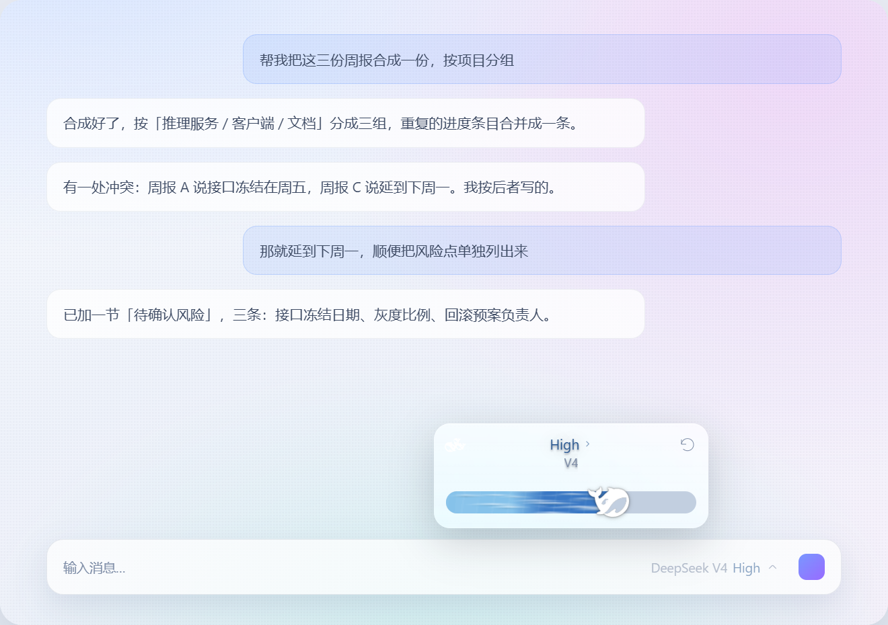
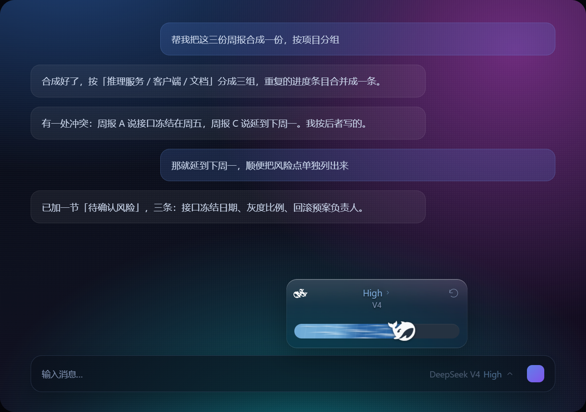
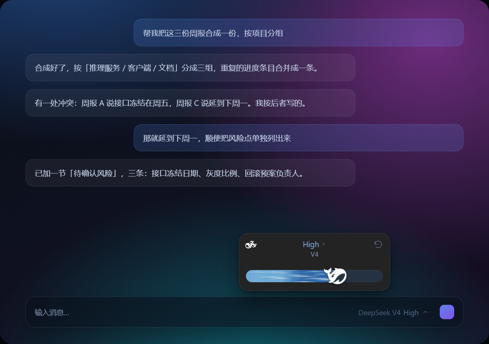
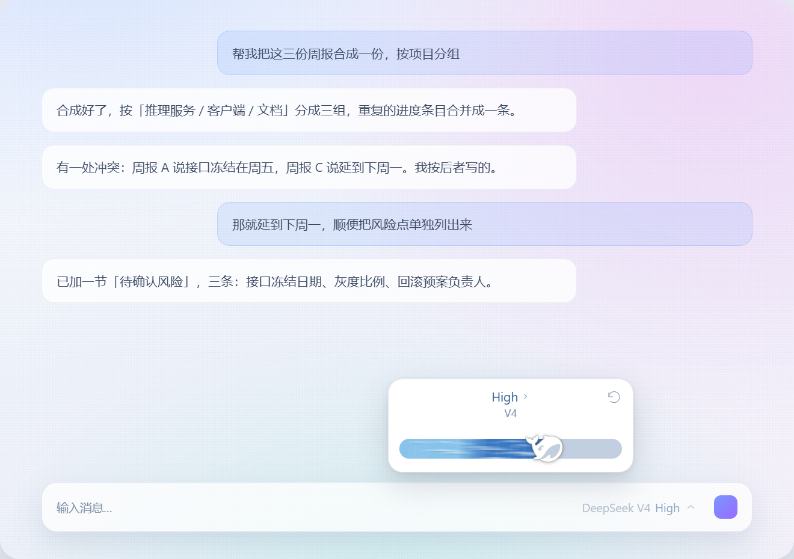
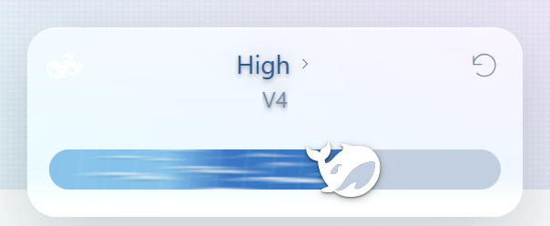
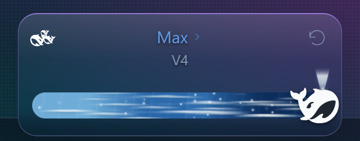
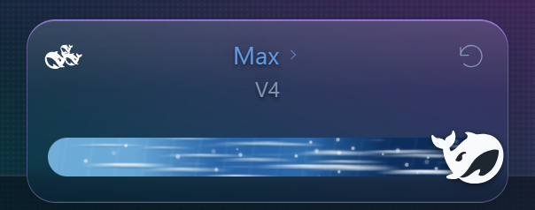
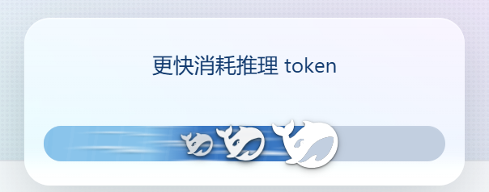
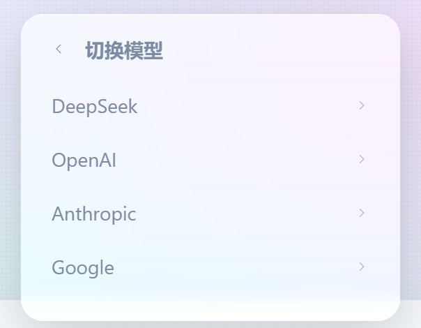
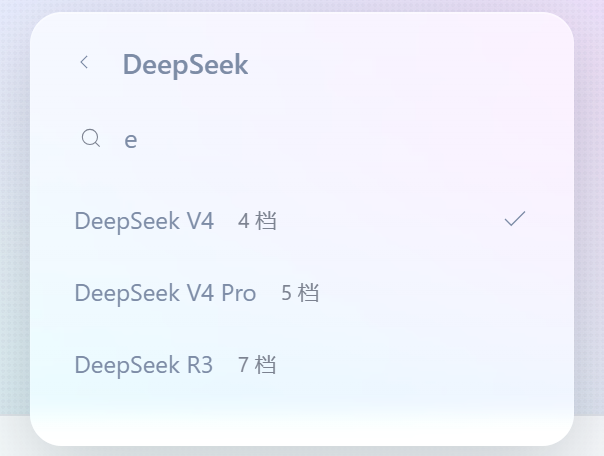

<!--
  发布前只有一处要改：把下文的 NineHill3690 换成你的 GitHub 用户名。
  package.json 的 repository / homepage 里是同一个占位符，一起换。
  badge 上的版本号跟着 tag 走；发布流程见文末「怎么发版」。
-->

<div align="center">

# 鲸鱼推理滑条

 **DSH 输入框里的推理档位滑条**：拖一下换档，海流跟着变急，推到底会喷气。

[](https://github.com/NineHill3690/dsh-whale-effort-slider/releases)
[](LICENSE)
[](package.json)

**[下载默认版](https://github.com/NineHill3690/dsh-whale-effort-slider/raw/main/site/downloads/dsh-whale-effort-slider-1.3.0-default.zip)**　·　**[下载液态玻璃版](https://github.com/NineHill3690/dsh-whale-effort-slider/raw/main/site/downloads/dsh-whale-effort-slider-1.3.0-glass.zip)**　·　**[怎么装](#3-安装步骤)**



</div>

---

<table>
<tr><td width="92" valign="top" style="white-space:nowrap"><b>项目名称</b></td><td>鲸鱼推理滑条 · <code>dsh-whale-effort-slider</code></td></tr>
<tr><td valign="top" style="white-space:nowrap"><b>项目目标</b></td><td>把 DSH 输入框里那个只显示模型名的按钮，换成一条带档位的推理强度滑条：拖动换档、就地切换厂商与模型，并把「智能体团队协作」开关收到同一处</td></tr>
<tr><td valign="top" style="white-space:nowrap"><b>核心功能</b></td><td>推理档位滑条 · 海流与到顶喷气动效 · 厂商 → 模型两级下钻列表 · 团队协作开关 · 深浅色主题自适应 · 双构建版本（实色 / 液态玻璃）</td></tr>
<tr><td valign="top" style="white-space:nowrap"><b>技术栈</b></td><td>React（宿主注入，无自建构建链）· Cordis 插件与席位系统 · 内联 CSS + CSS 自定义属性 · Web Animations API · 手写 SVG · Node.js ESM 工具脚本 · 零 npm 运行时依赖</td></tr>
</table>
---

## 1. 项目介绍

DSH 的输入框右下角原本是一个模型按钮，点开是一列模型。推理强度藏在别处，换一档要翻两层菜单。

这个插件把那一格换成了滑条：拖动拇指就是换档，点档位名就是换模型。滑条会自己看着档位变样子 —— 低档是平缓的水面，推到高档水色变深、海流变急。第一次推到底，鲸鱼头顶会喷一口水。

它不是独立窗口，也不是浮动面板：占用的是 DSH 输入框原有的「模型席位」，所以看上去就是界面的一部分。

**两个版本只差一行。** 两个包都从同一份 `client.js` 打出来，`build.mjs` 只翻转 `const GLASS = …` 这一行，其余逐字节相同。以后修 bug 一起生效，外观各取所需。

|  | 默认版（实色） | 液态玻璃版 |
|---|---|---|
| 面板 | 不透明卡片，主题色底 + 1px 描边 + 柔和投影 | 0.19 透明度 tint + 顶部釉光 + 6px 冻雾 + 四层边缘光 |
| GPU | 不需要合成层，老机器和关了硬件加速也稳 | 用 `backdrop-filter`，滚动时合成开销更高 |
| 可读性 | 文字直接压在底色上 | 背后有花哨壁纸时对比会弱一点 |
| 适合 | 日常用、长时间看、低配机 | 桌面有壁纸、能接受一点性能开销 |

两个包同名同席位，**只能装一个**。想换就先卸掉原来的。

<div align="center">

| 液态玻璃 · 深色 | 实色面板 · 深色 |
|---|---|
|  |  |
| **液态玻璃 · 浅色** | **实色面板 · 浅色** |
|  |  |

</div>

面板底色、描边、投影、文字墨色、滑条水色、鲸鱼填充都按主题取值，DSH 切深浅色时跟着换，不用重开面板。

## 2. 功能列表

<table>
<tr>
<td width="50%" valign="top">

<br><b>滑条就是档位</b><br>
<sub>拖到哪一档就是哪一档。拖动时指针事件按帧合并、填充走连续值不吸附，松手才落到最近刻度。</sub>
</td>
<td width="50%" valign="top">

<br><b>到顶喷一口水</b><br>
<sub>第一次推到最高档，鲸鱼头顶喷出一束水、十一粒水滴散开。来回蹭不会重复喷，只在真的到顶那一下。</sub>
</td>
</tr>
<tr>
<td width="50%" valign="top">

<br><b>Max 换材质</b><br>
<sub>到顶不只填满：海流的密度和速度拉满，多一层极光与气泡，深色主题下水色也换成更深的深海色。</sub>
</td>
<td width="50%" valign="top">

<br><b>团队协作开关</b><br>
<sub>点左侧那只淡鲸鱼，会话的智能体团队协作开或关。开着时滑条上多出三只逐渐变小的鲸鱼，档位名位置先闪一行提醒，随后退回档位名。</sub>
</td>
</tr>
<tr>
<td width="50%" valign="top">

<br><b>按厂商分组</b><br>
<sub>点档位名进列表。目录里有几个厂商就列几行，每行右边一个箭头往下钻，`Esc` 一层层往回退。</sub>
</td>
<td width="50%" valign="top">

<br><b>模型列表带搜索</b><br>
<sub>进组之后按档数排序（4 档、5 档、7 档），搜索框支持子序列匹配，方向键 / Home / End / Enter 都能用，当前模型打勾。</sub>
</td>
</tr>
</table>

另外几条不做图，说一下就行：

- **档位由模型给，不是写死的。** 模型上报几档就画几个刻度点，DeepSeek 常见是 Off / Low / High / Max 四档；没推理元数据的模型直接显示「此模型未提供推理强度」。
- **失败不连坐。** 模型目录拉不到时只在面板里显示一行错误，输入框和聊天不受影响，卸载即消失。
- **重置回到默认档。** 面板右上角那个回转箭头把当前模型打回它自己声明的默认档位。

## 3. 安装步骤

不用命令行，也不用构建，解压出来就是一个完整插件目录。

1. **完全退出 DSH Desktop**（托盘里也要退干净）。
2. 把解压出的文件夹放到一个不会被清理的位置，比如 `D:\plugins\dsh-whale-effort-slider`。
   别放下载目录，系统清理临时文件时容易连带删掉。
3. **设置 → 插件 → 添加插件**，选中那个文件夹，然后完全退出再重开 DSH。

命令行方式（非 desktop profile，或想用 npm 装）：

```powershell
# 本地目录
dsh plugin --profile <profile> add link:"<插件目录绝对路径>"

# 或用 npm 包名
dsh plugin --profile <profile> add dsh-whale-effort-slider
```

装之前要知道的几件事：

- 需要 `@deepseek-ai/dsh >= 0.2.0-rc.2 < 0.3.0`。
- **它顶掉的是官方模型选择器。** 插件占用输入框的模型席位并优先显示（`priority: -1`），装上之后输入框里看到的就是这条滑条。
- **别和官方选择器同时开。** 两个都声明同一个席位时，先声明的会被后者报错顶掉，历史上有过一次装完模型选择器整个消失的事故。
- **不声明 `conversation.input.model.label` 子槽位。** 抢声明会把官方注册打掉，代价是官方那个装饰徽标不显示。
- 只改输入框那一个位置，不注入 host hook，不碰会话数据。

## 4. 使用说明

**展开与收起**
点输入框右下角那个模型按钮展开面板，再点一次收起；点面板外面或按 `Esc` 也会收起。

**换档位**
按住滑条上的鲸鱼左右拖。拖动过程中填充是连续值、不吸附（不会一卡一卡地跳格），松手才吸附到最近的刻度。滑条本身的键盘操作：`←` `→` `↑` `↓` 一次一档，`Home` 最低档，`End` 最高档。

**换模型**
点滑条上方那行档位名（比如 `High ›`）进入模型列表。第一层是厂商，点某一行右侧的箭头进入第二层看该厂商的模型；第二层顶部有搜索框，输入 `e` 就能筛出名字里含 e 的模型（有序子序列匹配，不要求连续）。`↑` `↓` 移动高亮、`Enter` 选中、`Home` / `End` 跳到首尾。

**逐层返回**
`Esc` 按层级往回退：第二层 → 第一层 → 关闭面板。面板左上角那个 `‹` 同样是退一层。

**团队协作**
面板左上角那只淡鲸鱼是开关。打开后，当前会话的智能体团队协作生效，滑条上也多出三只逐渐变小的鲸鱼。

**重置**
面板右上角的回转箭头把当前模型打回它自己声明的默认档位（不是全局默认，是模型公布的那个 defaultEffort）。

## 5. 项目结构

```
dsh-whale-effort-slider/
├── client.js                  2,995 行 · 全部交互、动效与样式（单文件，无构建）
├── index.js                   宿主侧入口，空实现（插件 fail-open 的前提）
├── cordis.patch.yml           bundle 声明：把插件挂到 conversation.input.model 席位
├── package.json               插件清单（dsh.bundle / dsh.client / engines.dsh）
├── icon.svg                   插件图标：透明底 + 三鲸 + 鲸鱼旋钮
├── locale/
│   ├── zh.json                中文标题与描述（插件详情页显示的就是这里）
│   └── en.json                英文标题与描述
├── docs/
│   ├── HANDOFF.md             逐版改造记录、事故复盘、每个像素的来历
│   ├── DETAIL.md              席位与渲染细节（英文）
│   ├── DETAIL.zh.md           席位与渲染细节（中文）
│   └── REPLICA.md             上游复刻与验证记录
├── site/
│   ├── index.html             GitHub Pages 单页（介绍 + 下载 + 安装）
│   ├── img/                   README 与站点共用的十张截图
│   ├── downloads/             两个 zip 的副本，Pages 下载按钮指向这里
│   └── make-shots.py          截图生成脚本（离屏渲染 → 套聊天背景 → 裁切）
├── build.mjs                  双版本打包：翻转 GLASS 一行 → 两个 zip
├── render.mjs                 离屏渲染：不启动 DSH 也能出 HTML 供截图
├── render-trigger-probe.mjs   触发器位置探针（量按钮在输入框里的落点）
├── LICENSE                    MIT
├── NOTICE                     第三方图形与商标声明
└── dev/                       开发期草稿、旧包归档（.gitignore，不发布）
```

`client.js` 为什么是单文件：它要跑在宿主注入的模块加载器里，多一个文件就多一次解析；而且改一个像素不该触发构建。代价是这个文件很大，所以内部按「常量 → 纯函数 → 图标 → 子组件 → 主组件 → 插件对象」排布，每个段落头上都有注释说明它负责什么。

## 6. 截图占位符

下面每张图都标了建议尺寸和它该拍什么。换图时保持文件名和宽高比，README 与站点都不用改。

```markdown
<!-- 主图 · 1320×930 · 液态玻璃版浮在聊天输入框上方，背后有壁纸 -->


<!-- 对比图 · 1320×930 ×4 · 浅色/深色 × 玻璃/实色 -->
site/img/panel-glass-dark.png
site/img/panel-solid-dark.png
site/img/panel-glass.png
site/img/panel-solid.png

<!-- 功能特写 · 604×248 · 只截面板，不带聊天背景 -->
site/img/feat-effort.png     High 档，水柱填到鲸鱼旋钮
site/img/feat-spout.png      到顶瞬间，鲸鱼头顶喷水
site/img/feat-ultra.png      Max 档，海流拉满 + 极光
site/img/feat-team.png       团队协作开着，滑条上三只鲸鱼

<!-- 列表特写 · 604×470 · 只截面板 -->
site/img/feat-models.png     第一层：厂商列表
site/img/feat-models2.png    第二层：模型列表 + 搜索
```

重新生成这十张图：

```bash
python site/make-shots.py            # 离屏渲染 → 套背景 → 裁切，全流程
```

## 7. MIT License 说明

本项目以 **MIT** 发布，全文见 [LICENSE](LICENSE)。你可以自由使用、修改、再分发、商用，条件是保留版权声明与许可文本。

三条边界值得单独说清楚：

1. **`client.js` / `index.js` 的版权归上游作者**（`dsh-codex-model-effort-selector contributors`），本副本新增的清单、图标、详情页、文档同样按 MIT 发布。
2. **图标里的鲸鱼是 DeepSeek Harness 的 logo 路径**，版权归 DeepSeek（© 2026 DeepSeek，MIT），经上游的 MIT 代码传入本仓库。MIT 要求分发时保留该声明，所以 `LICENSE` 末尾和 [NOTICE](NOTICE) 里都写了。
3. **本项目是独立第三方插件，非 DeepSeek 官方出品**，未经官方审核或背书。商标权不随 MIT 授予 —— 那只鲸鱼只用来表示「这个插件管的是哪一条滑条」，不代表任何官方关系。详见 [NOTICE](NOTICE)。

---

## 从哪来

起点是 [ABING1111/dsh-codex-model-effort-selector](https://github.com/ABING1111/dsh-codex-model-effort-selector) v1.1.2（MIT）。**v1.3.0 起改名 `dsh-whale-effort-slider`**，作为独立插件与上游条目脱钩，改动不再被上游更新覆盖。

逐版改造记录、事故复盘、每个像素的来历都在 [`docs/HANDOFF.md`](docs/HANDOFF.md)；站点源码在 [`site/`](site/)。

<details>
<summary>怎么发版（维护者自己看）</summary>

```powershell
node build.mjs     # 产出 dist/<name>-<ver>-default.zip、-glass.zip、build-manifest.json
```

1. 改 `package.json` 的 `version`，同步 badge 上的版本号。
2. 跑 `node build.mjs`。
3. GitHub 建一个 `v<ver>` 标签的 Release，把 `dist/` 里两个 zip 传成资产。
4. 把 `dist/` 里两个 zip 复制进 `site/downloads/`，Pages 上的下载按钮才指向最新版。
5. 仓库设置 → Pages → Source 选 `main` + `/site`。

想进插件市场（可搜索、一键安装）：`npm publish` 之后去
[awesome-dsh-plugin](https://github.com/awesome-dsh-plugin/awesome-dsh-plugin) 提 PR 加一条。
市场索引只收录 npm 上发布过的包，只发 Release 不会被搜到。

</details>
